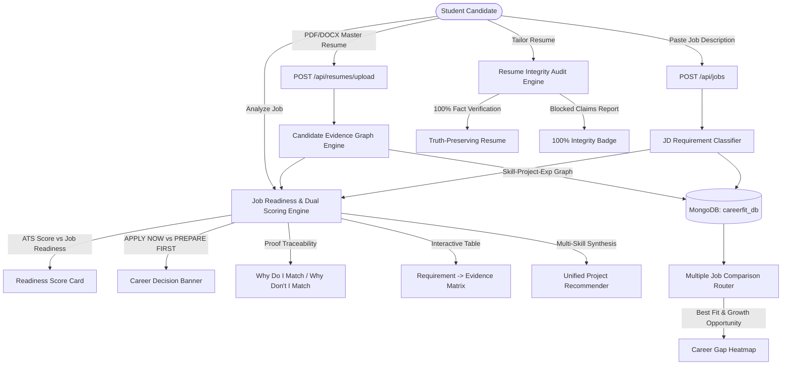

# AI CareerFit — Evidence-Based Job Readiness & Resume Personalization

**AI CareerFit** is a full-stack, production-quality AI-powered student career readiness platform. It shifts the paradigm from simple ATS keyword matching to **evidence-based career readiness evaluation**, modeling candidate knowledge graphs, evaluating proof strength (Levels 0–4), computing dual metrics (**ATS Compatibility Score** vs **Job Readiness Score**), issuing explicit **APPLY NOW vs PREPARE FIRST** guidance, recommending single multi-skill projects to bridge gaps, and enforcing a **100% Resume Integrity Guarantee**.

---

## What Makes AI CareerFit Different?

Traditional resume tools are simple ATS keyword matchers that tell students to copy keywords into their resume. **AI CareerFit** is an Explainable Career Readiness Engine:

```text
Job Requirements
        +
Candidate Evidence Graph (Levels 0–4)
        +
Explainable Matching ("Why Do I Match?" / "Why Don't I Match?")
        +
Dual Scoring (ATS Compatibility vs Job Readiness)
        +
Decision System (APPLY NOW vs PREPARE FIRST)
        +
Personalized Learning Roadmap
        +
Single Unified Project Recommender
        +
100% Resume Integrity Guarantee (Audit & Block Unsupported Claims)
```

---

## Enhanced Architecture Diagram



---

## Candidate Evidence Levels

For every skill, AI CareerFit calculates an evidence level:
- **Level 0 — No Evidence**: Skill is required by the job but missing from the candidate profile.
- **Level 1 — Mentioned**: Skill appears in the skills list without detailed supporting project text.
- **Level 2 — Project Evidence**: Skill was implemented in 1 student project.
- **Level 3 — Multiple Evidence**: Skill is backed across multiple projects or certifications.
- **Level 4 — Professional Evidence**: Skill is supported by work experience / internship with responsibilities.

---

## Key Features

1. **Dual Scoring System**:
   - **ATS Compatibility Score**: Measures keyword occurrence and layout formatting.
   - **Job Readiness Score**: Evaluates Evidence Levels (0–4), Must-Have requirement coverage, and project/experience proof depth.
2. **Career Decision Engine**:
   - **APPLY NOW**: Issued when readiness $\ge 75\%$ with no critical must-have blockers.
   - **PREPARE FIRST**: Issued when readiness $< 75\%$ or key blockers exist, detailing top blockers and estimated prep weeks (e.g. 3–6 weeks).
3. **"Why Do I Match?" & "Why Don't I Match?"**: Natural language explainable AI detailing concrete evidence or exact reasons for missing skills.
4. **Single Unified Project Recommender**: Synthesizes a single project proposal (e.g., *Cloud-Native Task Portal*) covering multiple missing requirements simultaneously.
5. **Requirement $\rightarrow$ Resume Coverage Matrix**: Interactive table detailing evidence levels and section locations for every job requirement.
6. **100% Resume Integrity Guarantee**: Compares every generated claim against candidate graph data, blocking unsupported claims and outputting an Integrity Audit Report.
7. **Multiple Job Gap Heatmap**: Evaluates candidate readiness across all target positions, highlighting **Best Current Fit**, **Best Growth Opportunity**, and **Highest-Value Skill to Learn**.

---

## Tech Stack

### Frontend
- **Framework**: React 18 + Vite
- **Styling**: Tailwind CSS (Dark Mode Glassmorphism)
- **Routing**: React Router v6
- **Icons**: Lucide React
- **API Client**: Axios with Bearer token interceptor

### Backend
- **Framework**: Python 3.14 / FastAPI
- **Validation**: Pydantic v2 & ConfigDict
- **Security**: PyJWT + Direct Native `bcrypt`
- **Database Driver**: Motor (AsyncIO MongoDB driver)
- **Document Processing**: `pypdf`, `pdfplumber`, `python-docx`
- **Resume Export**: `reportlab` (PDF) & `python-docx` (DOCX)
- **AI Abstraction**: Gemini 2.5 Flash, OpenAI GPT-4o-mini, & Local Fallback

---

## How to Run Locally

### 1. Backend Setup

```bash
cd backend
pip install -r requirements.txt
python seed_demo_data.py
python -m uvicorn app.main:app --reload --port 8000
```
Backend API will be running at `http://localhost:8000`.  
Swagger API Docs: `http://localhost:8000/docs`

### 2. Frontend Setup

```bash
cd frontend
npm install
npm run dev
```
Frontend App will be running at `http://localhost:5173`.

---

## Running Tests

```bash
cd backend
python -m pytest tests/
```
*Executes 8/8 automated unit & integration tests for evidence levels, dual scoring, project recommendation, integrity auditing, and matching.*

---

## Demo Credentials

- **Email**: `student@careerfit.ai`
- **Password**: `Password123`
*(Includes pre-seeded Master Resume and Acme Software Corp target job description).*
